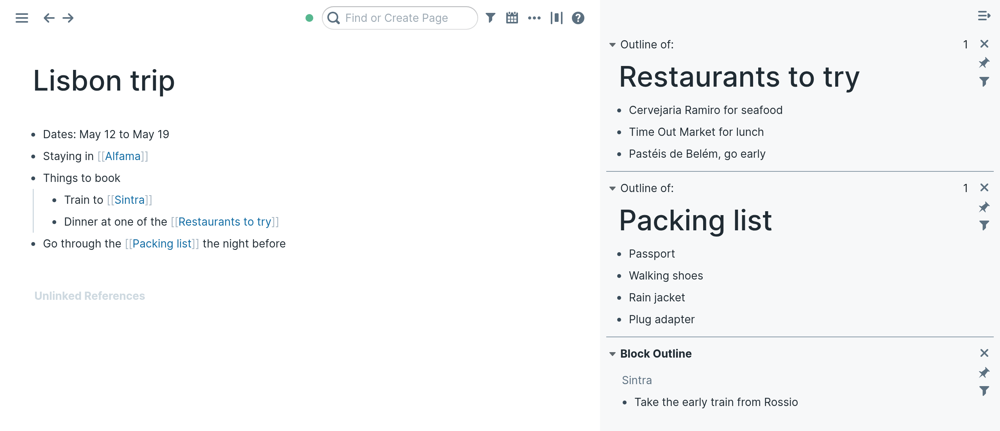
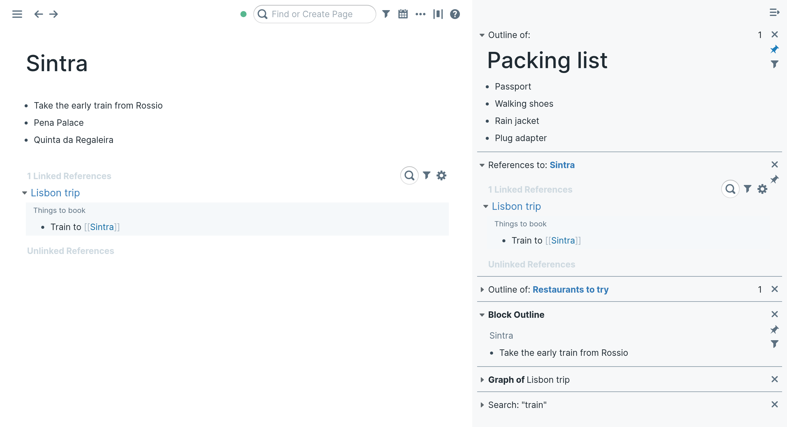
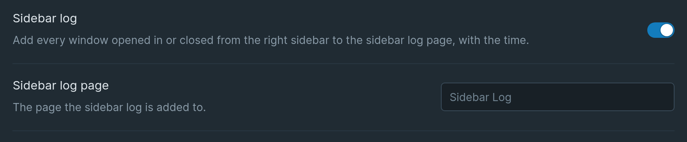
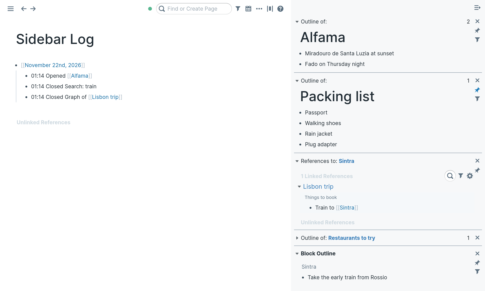
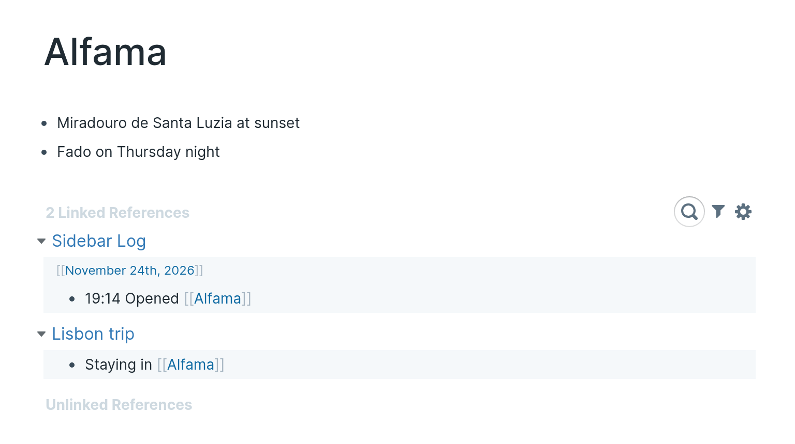

# Persistent Sidebar

Everything in your right sidebar comes back after you restart Roam.

Roam forgets the right sidebar when you quit or reload, unless you pin each window. Persistent Sidebar keeps
every window that's open there and puts them all back, in the same order, the next time you open the graph.

Nothing is pinned for you. Nothing is written to your graph unless you turn on the
[sidebar log](#sidebar-log), and nothing is sent over the network.

## Getting started

1. Install **Persistent Sidebar** from Roam Depot.
2. Use the right sidebar as usual. There's nothing to set up.

The picture above is Roam just after it was quit and opened again: the two pages and the block that were in
the sidebar are back where they were.

To go back to Roam's normal sidebar, turn the extension off in **Settings → Roam Depot**.

## What comes back

| | After a restart |
| --- | --- |
| **Every kind of window** | Pages (**Outline of:**), blocks (**Block Outline**), references (**References to:**), graph views (**Graph of**) and searches (**Search**). |
| **Order** | Windows are in the order you left them, top to bottom. |
| **Collapsed windows** | A window you folded with its caret comes back folded. |
| **Pinned windows** | A window you pinned stays pinned. No other window is pinned. |
| **The sidebar itself** | If you had the sidebar closed, it stays closed, with its windows in it for when you open it. |

The sidebar is saved as you use it, so it also comes back after a crash or a forced quit. If a page or
block in the sidebar was deleted in the meantime, its window is left out.

## Sidebar log

The sidebar log is an optional record of everything you open in and close from the right sidebar. It's
**off unless you turn it on**.

Turn it on in **Settings → Persistent Sidebar**:

| Setting | What it does | To start with |
| --- | --- | --- |
| **Sidebar log** | Adds every window opened in or closed from the right sidebar to the sidebar log page, with the time. | Off |
| **Sidebar log page** | The page the log is added to. Type another page's name to use that page. | Empty, which means the page **Sidebar Log** |

### What the log looks like

Each day gets one block that links to that day's daily note. Under it there's one line for each window you
opened or closed, with the time:

The lines are worded like the window headers in Roam's sidebar:

| In the sidebar | In the log |
| --- | --- |
| Open a page | `14:05 Opened [[Alfama]]` |
| Open a block | `14:06 Opened ((block))`, as a block reference |
| Close the references to a page | `14:20 Closed References to: [[Sintra]]` |
| Close a graph view | `14:21 Closed Graph of [[Lisbon trip]]` |
| Close a search | ``14:21 Closed Search: `train` ``, with the search text as code |

Search text goes into the log as code, so brackets, tags or anything else you typed into a search stay
plain text there and link to nothing.

### The log in Linked References

The lines link to the pages and blocks themselves. So a page that has been in your sidebar lists those
times in its **Linked References**, and each daily note lists what you had in the sidebar that day.

## Privacy

- **Stays on this computer.** The saved sidebar is kept in the Roam app's storage on this computer. The
  extension makes no network requests.
- **Not in your graph.** The saved sidebar isn't stored in your graph, so people you share the graph with
  don't see it or get it.
- **The log is the exception.** With **Sidebar log** on, the log page is an ordinary page in your graph.
  Anyone who can read the graph can read it.

<b>Where the sidebar is kept</b>

The windows, their order, which are collapsed or pinned, and whether the sidebar is open are saved under
the graph's name in the Roam app's own storage on your computer (the browser's local storage and
IndexedDB). They're saved again a moment after every change, and written straight to disk so that a crash
doesn't lose them.

The two settings above are ordinary Roam extension settings, which Roam keeps with the graph.

## Limitations

- **One computer at a time.** The sidebar is kept on the computer you're using, separately for each graph.
  It doesn't follow you to another computer or browser: each one keeps its own sidebar for the graph, and
  a computer you haven't used the graph on starts with Roam's normal sidebar. Following you between
  computers is [on the list](https://github.com/sweenzor/roam-persistent-sidebar/issues/2).
- **Clearing Roam's site data** on a computer clears the saved sidebar there.

## Coming from Autopin

Persistent Sidebar replaces [Autopin](https://github.com/sweenzor/roam-autopin), which kept the sidebar by
pinning every window. Turn Autopin off when you turn this on. Windows Autopin pinned stay pinned until you
unpin them.

## Feedback and source

Report problems or ideas at
[github.com/sweenzor/roam-persistent-sidebar/issues](https://github.com/sweenzor/roam-persistent-sidebar/issues).
The source code and changelog are at
[github.com/sweenzor/roam-persistent-sidebar](https://github.com/sweenzor/roam-persistent-sidebar).
